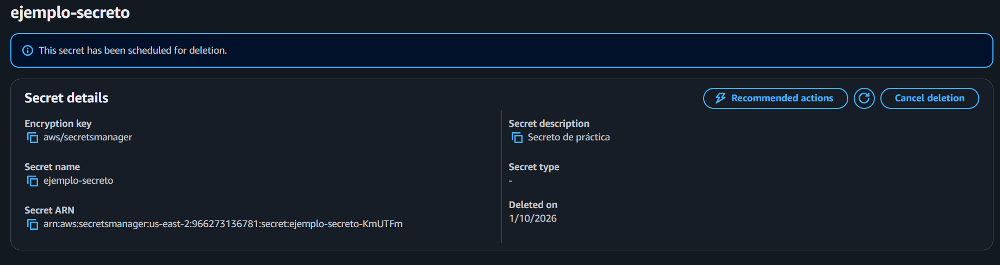

# **¿Qué es AWS Secrets Manager?**
Secrets Manager es un servicio de AWS que permite crear, administrar, recuperar y rotar distintos tipos de secretos, como lo son credenciales de bases de datos o aplicaciones, tokens OAuth, llaves API, llaves de encripción, llaves SSH, etc. Para determinar quién puede acceder a qué secretos y qué nivel administrativo tienen sobre estos, Secrets Manager utiliza el sistema de identificación de AWS, IAM, conjuntamente con la gran variedad de permisos que AWS permite dar a distintos usuarios para controlar su acceso. Las principales funciones de Secrets Manager son las siguientes:
- Crear secretos: se crea una referencia a un string con el formato específico requerido.
- Recuperar secretos: desde el código de una aplicación, se crea una llamada a Secrets Manager con la cual se accede al secreto requerido, sin tener que poner el texto de este directamente en el código.
- Rotar secretos: se actualiza un secreto, de acuerdo con varias configuraciones de cuándo y cómo debería realizarse esta acción.

# **Creación de un secreto y acceso desde código externo**
1. Acceder a Secrets Manager desde la consola de AWS.
2. Elegir la opción "Store a new secret".
3. Para el tipo de secreto, se usará "Other type of secret" para solamente crear un usuario y contraseña ficticios.
4. En la sección Key/value pairs, cambiar a la pestaña Plaintext y poner el siguiente JSON:
{
  "username": "usuario_prueba",
  "password": "Clave12345!"
}
5. Dejar la llave de encripción predeterminada, aws/secretsmanager.
6. Pasar a la siguiente sección.
7. Darle un nombre y una descrpción al secreto. 
8. Pasar a la siguiente sección.
9. No crear configuraciones de rotación, no se necesitan para este ejemplo.
10. Pasar a la siguiente sección y confirmar que todo esté correcto.
11. Dar clic en "Store" para crear el secreto.
12. Acceder a IAM y crear una nueva política.
13. Buscar los permisos de Secrets Manager, y en la sección "Read", seleccionar "GetSecretValue" para permitir el acceso al secreto creado en este ejemplo.
14. En la sección "Resources", crear un ARN con la región donde se haya creado el secreto y el nombre de este.
15. Pasar a la siguiente sección, confirmar que todo esté en orden y crear la política.
16. Acceder a la configuración de la política y, en la sección "Permissions", editar el JSON en la fila "Resource", poniendo la secuencia de caracteres -* al final del ARN para que no haya problemas de acceso desde Python.
17. Ejectutar el archivo de Python (incluido en esta carpeta) y comprobar que devuelve el string correcto.
18. Desde Secrets Manager, cambiar los valores del secreto y confirmar que el código los recupera correctamente sin necesidad de cambiarlos.

# **Costos**
- Por cada secreto, se cobra USD $0.40 mensualmente. Por cada 10000 llamadas API, se cobra USD $0.05.
- Si se consulta el mismo secreto repetidamente, aun así su valor sea el mismo, el costo escalará: como se cobra cada 10000 llamadas, un servicio que llama a la API 1 millón de veces por día valdrá 150 dólares mensuales, aunque la mayoría de esas llamadas sean redundantes.
- Cuando debe accederse a un mismo secreto muchas veces seguidas y este no rota muy frecuentemente, conviene almacenarlo en la memoria para no tener que hacer llamadas innecesarias a la API.

# **Evidencia de eliminación del secreto de prueba**
