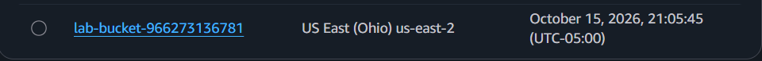
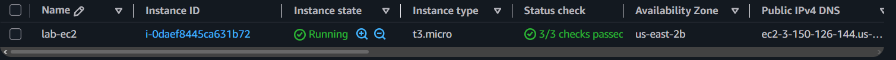
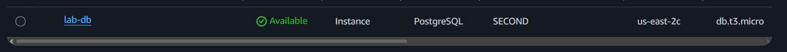
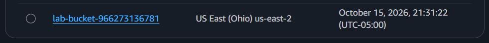
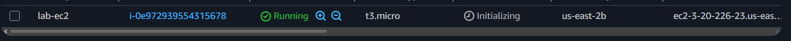
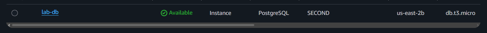

# **¿Qué es Terraform?**
Terraform es una herramienta de código como infraestructura que permite definir recursos locales y en la nube como archivos de configuración legibles que pueden ser versionados, reutilizados y compartidos. Para poder acceder a una plataforma de servicios en la nube, Terraform utiliza una herramienta llamada provider, que es específica para cada servicio. El flujo de trabajo tiene tres fases:
- Escribir: el usuario define recursos, que pueden ser para múltiples plataformas en la nube.
- Planear: teniendo en cuenta la infraestructura actual y la nueva configuración, Terraform crea un plan de ejecución que describe la estructura que va a crear, actualizar o eliminar.
- Aplicar: al aprobarse el plan, Terraform realiza las operaciones propuestas en el orden correcto, respetando las dependencias de cada recurso.

# **Permisos requeridos para la actividad**
Para llevar a cabo la actividad, lo más simple es asignarle al usuario de IAM las políticas AmazonS3FullAccess, AmazonEC2FullAccess y AmazonRDSFullAccess. Las siguientes acciones son necesarias:
- S3: CreateBucket, DeleteBucket, ListBucket, GetBucketLocation, PutBucketTagging, etc.
- EC2: RunInstances, TerminateInstances, CreateTags, CreateSecurityGroup, DeleteSecurityGroup, Authorize/RevokeSecurityGroupIngress/Egress, Describe*, CreateVpc, CreateSubnet, CreateInternetGateway, AttachInternetGateway, CreateRouteTable, CreateRoute, etc.
- RDS: CreateDBInstance, DeleteDBInstance, ModifyDBInstance, CreateDBSubnetGroup, DeleteDBSubnetGroup, DescribeDB*, AddTagsToResource, ListTagsForResource, etc.
- Secreto de RDS: CreateSecret, TagResource, DescribeSecret, DeleteSecret, kms.
- Primer uso de RDS: iam:CreateServiceLinkedRole.

# **Configuración de user_cli y verificación de permisos**
1. Acceder a IAM desde la consola de AWS y elegir "Users" y luego "Create user".
2. Darle el nombre `user_cli`. No es necesario darle acceso a la consola de AWS, pues solo se usará desde herramientas.
3. En la sección de permisos, elegir "Attach policies directly" y seleccionar AmazonS3FullAccess, AmazonEC2FullAccess y AmazonRDSFullAccess.
4. Crear una política propia con las acciones restantes de la sección anterior (Secrets Manager: CreateSecret, TagResource, DescribeSecret, DeleteSecret y GetSecretValue; kms; e iam:CreateServiceLinkedRole) y adjuntarla al usuario.
5. Pasar a la siguiente sección, confirmar que todo esté correcto y dar clic en "Create user".
6. Abrir el usuario creado, ir a la pestaña "Security credentials" y elegir "Create access key".
7. Seleccionar el caso de uso "Command Line Interface (CLI)", confirmar y crear la llave. Guardar el Access Key ID y el Secret Access Key en un lugar seguro, pues el segundo solo se muestra una vez. Estos valores nunca deben subirse a GitHub ni aparecer en capturas.
8. Instalar AWS CLI v2, Terraform y Python con Boto3 (`pip install boto3`).
9. En WSL, ejecutar `aws configure` e ingresar el Access Key ID, el Secret Access Key, la región `us-east-2` y el formato de salida `json`.
10. Verificar que no se esté usando la cuenta raíz ejecutando `aws sts get-caller-identity`. El campo `Arn` debe terminar en `user/user_cli`.
11. Si algún comando falla con `AccessDenied`, el mensaje indica cuál es la acción que falta. Agregarla a la política propia y volver a ejecutar el comando.

# **Despliegue con Terraform**
1. Abrir una terminal en la carpeta `terraform`, que contiene `main.tf` y `.gitignore`. El archivo `main.tf` no contiene llaves ni contraseñas: Terraform toma las credenciales de `~/.aws/credentials`.
2. Ejecutar `terraform init` para descargar el provider de AWS.
3. Ejecutar `terraform plan` y revisar los recursos que se van a crear (bucket de S3, instancia EC2, instancia RDS, grupos de seguridad y secreto). Todavía no se ha creado nada. Tomar captura del resultado.
4. Anotar la hora de inicio y ejecutar `terraform apply`. Escribir `yes` para aprobar el plan. La creación de RDS tarda entre 5 y 10 minutos. Tomar captura del resultado.
5. Verificar en la consola de AWS que existan el bucket `lab-bucket-<id de la cuenta>`, la instancia EC2 `t3.micro`, la instancia RDS PostgreSQL `db.t3.micro`, los grupos de seguridad `lab-ec2-sg` y `lab-rds-sg`, y el secreto de la contraseña de RDS en Secrets Manager. Tomar capturas sin que se vean credenciales.
6. Confirmar que `terraform.tfstate` no se suba a Git (el archivo `.gitignore` ya lo excluye) y que no contenga la contraseña de la base de datos, solo el ARN del secreto.
7. Ejecutar `terraform destroy` y escribir `yes`. Anotar la hora de finalización y tomar captura del resultado.
8. Revisar en la consola que no queden recursos: bucket de S3, instancia EC2 (estado "Terminated"), instancia RDS, grupos de seguridad y secreto.

# **Despliegue con Boto3**
1. Confirmar que los recursos de la versión de Terraform ya fueron eliminados.
2. Abrir una terminal en la carpeta `boto3`, que contiene `deploy.py` y `destroy.py`.
3. Ejecutar `python deploy.py`. El programa crea el bucket, los grupos de seguridad, la instancia EC2 y la instancia RDS, espera a que estén listos y guarda los IDs de lo creado en `ids.json`. También imprime el ARN del secreto de RDS.
4. Verificar en la consola de AWS que los recursos existan y tomar capturas.
5. Ejecutar `python destroy.py`, que lee `ids.json` y elimina todo lo creado.
6. Revisar en la consola que no queden recursos y tomar captura.

# **Despliegue con AWS CLI**
1. Confirmar que los recursos de la versión de Boto3 ya fueron eliminados.
2. Abrir una terminal de WSL en la carpeta `cli`, que contiene `deploy.sh` y `destroy.sh`.
3. Ejecutar `./deploy.sh` para crear los recursos con comandos de `aws`.
4. Si aparece el error `Permission denied`, ejecutar `chmod +x deploy.sh destroy.sh`. Si aparece `bad interpreter` o `\r: command not found`, los archivos tienen saltos de línea de Windows: corregirlo con `sed -i 's/\r$//' deploy.sh destroy.sh` y volver a ejecutar.
5. Recordar que WSL tiene su propio archivo `~/.aws/credentials`, separado del de Windows, por lo que `aws configure` debe ejecutarse dentro de WSL.
6. Verificar en la consola de AWS que los recursos existan y tomar capturas.
7. Ejecutar `./destroy.sh` para eliminar todo lo creado.
8. Revisar en la consola que no queden recursos y tomar captura.
9. Como alternativa en PowerShell, se pueden usar `.\deploy.ps1` y `.\destroy.ps1`. Si PowerShell bloquea la ejecución, usar `Set-ExecutionPolicy -Scope Process Bypass` y volver a intentar.

# **Lectura de la contraseña de RDS desde Python**
1. Copiar el ARN del secreto de RDS, que imprimen los scripts o se encuentra en Secrets Manager.
2. Verificar que `user_cli` tenga el permiso `secretsmanager:GetSecretValue` sobre ese secreto.
3. Recuperar el secreto con `boto3` (`get_secret_value`), con el mismo código del punto 1. La contraseña se obtiene en tiempo de ejecución y nunca se escribe en el código.

# **Autenticación de user_cli en las herramientas**
El usuario IAM user_cli se autentica mediante un par de llaves de acceso (Access Key ID y Secret Access Key) generadas desde IAM. Estas llaves se guardan localmente ejecutando `aws configure`, que las escribe en el archivo `~/.aws/credentials` (dentro de WSL, en este caso) y guarda la región en `~/.aws/config`. AWS CLI, Boto3 y Terraform usan la misma cadena de credenciales predeterminada: primero revisan las variables de entorno (`AWS_ACCESS_KEY_ID` y `AWS_SECRET_ACCESS_KEY`) y, si no las encuentran, leen esos archivos. Por esta razón no es necesario escribir ninguna llave en `main.tf` ni en los scripts. Con las llaves, AWS firma cada solicitud y reconoce que viene de user_cli, y lo que este puede hacer lo determinan las políticas de IAM que tiene adjuntas.

Las llaves de acceso no pueden guardarse en Secrets Manager porque, para leer un secreto, la herramienta ya debe estar autenticada en AWS: las llaves tienen que existir antes, y por fuera de Secrets Manager. Además, la contraseña de la base de datos es una credencial distinta, que sirve para entrar a RDS y no a AWS. Por esto se configuró RDS con `manage_master_user_password = true`, de modo que sea RDS quien genere esa contraseña y la guarde en Secrets Manager. En un proyecto real, también sería preferible usar credenciales temporales (SSO o roles) en lugar de llaves de larga duración.

# **Información que conserva el archivo de estado de Terraform**
El archivo `terraform.tfstate` es un JSON en texto plano donde Terraform guarda, para cada recurso que administra, su ID real y todos sus atributos (IDs de instancias, ARNs, el endpoint de RDS, grupos de seguridad, etc.). Con esto sabe qué recursos existen y los compara con la configuración en el siguiente `plan`. Si una contraseña se pasa como argumento a un recurso, queda guardada en el estado en texto plano, incluso si la variable se marca como `sensitive`. Para evitarlo, se usó `manage_master_user_password = true`: así el estado solo contiene el ARN del secreto, y la contraseña nunca pasa por Terraform. Además, el archivo de estado se excluye de Git con `.gitignore`, y en un proyecto real debería guardarse en un backend remoto cifrado, como un bucket de S3 con acceso restringido.

# **Costos**
Los valores siguientes son aproximados para la región us-east-2 y asumen una instancia EC2 t3.micro con 8 GB de EBS y una IP pública, una instancia RDS db.t3.micro con 20 GB de almacenamiento, un bucket de S3 vacío y el secreto de RDS.

| Componente | Precio aproximado | 1 hora | 1 semana |
|---|---|---|---|
| EC2 t3.micro | USD $0.0104/h | $0.010 | $1.75 |
| IPv4 pública | USD $0.005/h | $0.005 | $0.84 |
| EBS 8 GB | USD $0.08/GB-mes | $0.001 | $0.15 |
| RDS db.t3.micro | USD $0.017/h | $0.017 | $2.86 |
| Almacenamiento RDS 20 GB | USD $0.115/GB-mes | $0.003 | $0.53 |
| S3 (vacío) | casi USD $0 | $0 | $0 |
| Secreto de RDS | USD $0.40/mes | $0.0005 | $0.09 |
| **Total** | | **≈ $0.04** | **≈ $6.2** |

- Casi todos los componentes siguen generando cargos sin recibir tráfico. EC2 y RDS se cobran por hora mientras estén encendidos. El almacenamiento (EBS y RDS) se cobra mientras exista, incluso si la instancia EC2 está apagada. La IP pública se cobra mientras esté asignada, y el secreto se cobra mensualmente (prorrateado). El bucket de S3 vacío casi no cuesta, y la VPC predeterminada y los grupos de seguridad no tienen costo.
- El secreto de RDS añade USD $0.40 al mes más USD $0.05 por cada 10000 llamadas a la API, lo cual es una fracción muy pequeña (alrededor del 2%) del costo semanal frente a la instancia de RDS. Como se usa la llave de encripción predeterminada (aws/secretsmanager), no hay costo adicional por KMS.

# **Evidencias**
Capturas de la consola de AWS (región us-east-2) tomadas tras cada despliegue. Las salidas de los programas están en `boto3/evidencias/salida-*.txt` y `cli/evidencias/salida-*.txt`, y la eliminación de recursos queda registrada en los `salida-destroy.txt`.

**Boto3**

| Bucket de S3 | Instancia EC2 | Instancia RDS |
|---|---|---|
|  |  |  |

**AWS CLI**

| Bucket de S3 | Instancia EC2 | Instancia RDS |
|---|---|---|
|  |  |  |
