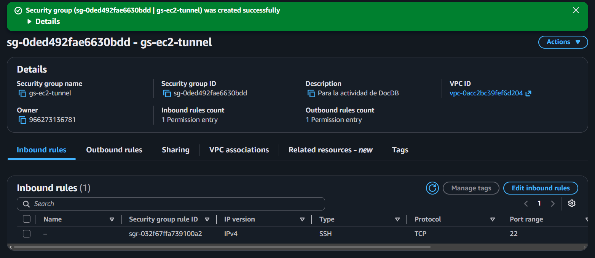
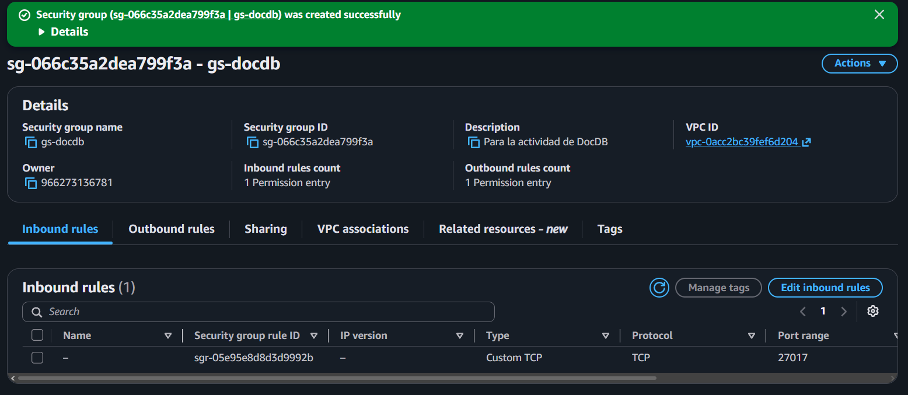
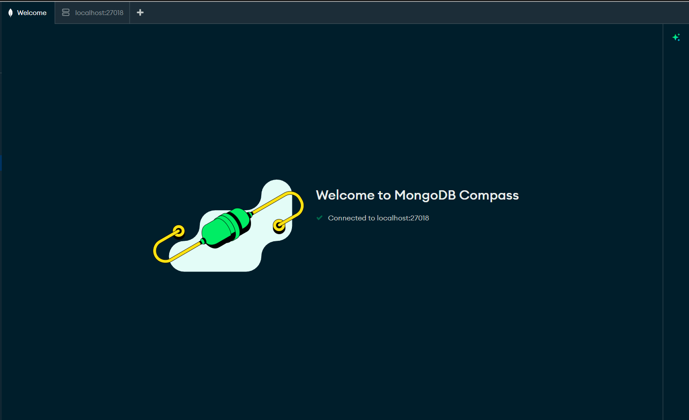
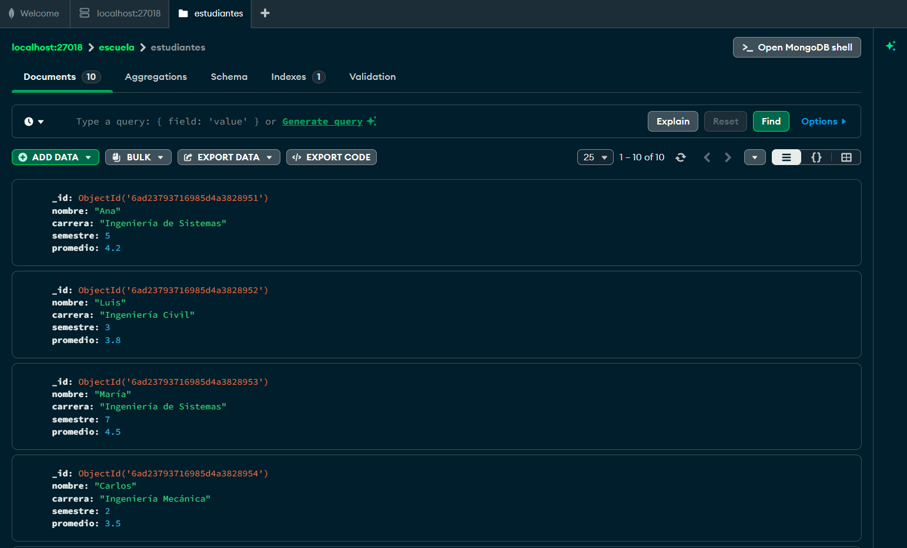
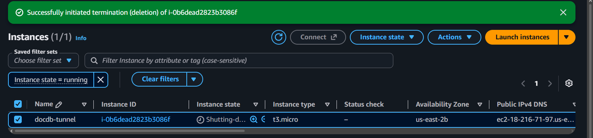
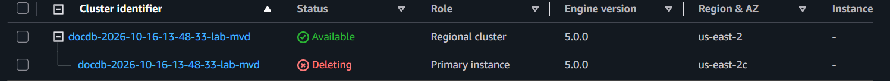
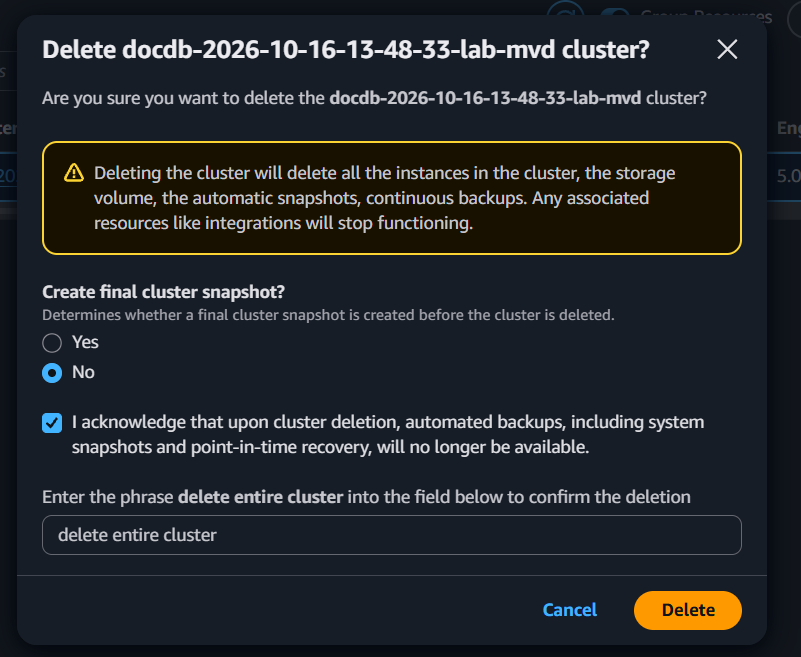
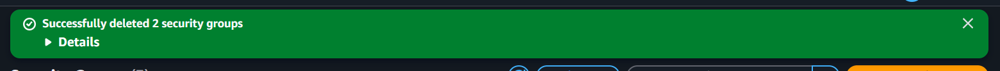

# **¿Qué es Amazon DocumentDB?**
Amazon DocumentDB es un servicio administrado de AWS de bases de datos de documentos, compatible con la API de MongoDB. Los datos se guardan como documentos JSON (BSON) agrupados en colecciones, por lo que cada documento puede tener una estructura distinta. AWS se encarga de aprovisionar el hardware, aplicar parches, hacer copias de seguridad y mantener la disponibilidad, y el usuario solo se conecta con los drivers y herramientas de MongoDB (PyMongo, Compass, etc.). Un clúster de DocumentDB está formado por:
- Un volumen de almacenamiento compartido, que se replica automáticamente en tres zonas de disponibilidad y crece según se necesite.
- Una instancia primaria (de escritura) y hasta 15 réplicas de lectura.
- Un endpoint del clúster, que siempre apunta a la instancia primaria, y un endpoint de lectura que reparte las lecturas entre las réplicas.

# **Diferencias entre DocumentDB y MongoDB que podrían afectar una aplicación existente**
1. **DocumentDB emula la API de MongoDB, no es MongoDB.** DocumentDB implementa la API de MongoDB sobre un motor propio de AWS, por lo que algunos operadores, etapas de agregación, tipos de índices y funciones no están soportados o se comportan distinto (por ejemplo, `$where` y el JavaScript del lado del servidor). Una aplicación que dependa de esas funciones tendría que reescribir consultas. Además, DocumentDB solo es compatible con ciertas versiones de la API de MongoDB, y no con las más recientes.
2. **Red y conexión.** DocumentDB solo existe dentro de una VPC y no tiene endpoint público, así que una aplicación que hoy se conecta a MongoDB por internet (por ejemplo, a MongoDB Atlas) debe moverse a la VPC o conectarse mediante un túnel SSH, una VPN o Direct Connect. Además, TLS viene activado por defecto y se debe usar el certificado de AWS (`global-bundle.pem`), y la cadena de conexión puede requerir opciones propias (como `directConnection=true` o `tlsAllowInvalidHostnames=true` al usar un túnel).
3. **Arquitectura y escalamiento.** En DocumentDB el almacenamiento está separado del cómputo: hay un volumen compartido, una sola instancia de escritura y hasta 15 réplicas de lectura. En MongoDB cada nodo de un replica set guarda su propia copia de los datos, y el escalamiento horizontal se hace con sharding configurable. Una aplicación diseñada para un clúster con sharding de MongoDB tendría que rediseñarse o usar DocumentDB Elastic Clusters, que es un modo distinto del servicio.
4. **Licencia y portabilidad.** MongoDB se distribuye bajo la licencia SSPL y puede ejecutarse en cualquier lugar (local, otras nubes, Atlas). DocumentDB solo funciona en AWS, lo que genera dependencia del proveedor.

# **Despliegue de bajo costo**
- Un clúster basado en instancias con una sola instancia `db.t3.medium` (la clase más pequeña disponible) y sin réplicas.
- Un clúster con una instancia Serverless, con capacidad mínima de 0.5 DCU y máxima de 2 DCU.
- Retención de copias de seguridad de 1 día (el mínimo), sin Performance Insights ni registros adicionales.
- Contraseña administrada por AWS Secrets Manager (`Managed in AWS Secrets Manager`).
- Una instancia EC2 `t3.micro` en la subred pública de la VPC predeterminada, que solo sirve como puente para el túnel SSH.
- Todos los recursos se eliminaron al terminar la práctica, para que no sigan generando cargos.

# **Creación de los grupos de seguridad**
1. Acceder a EC2 desde la consola de AWS y, en el menú izquierdo, elegir "Security Groups".
2. Dar clic en "Create security group".
3. Para el grupo de la EC2, usar el nombre `sg-ec2-tunnel`, una descripción y la VPC predeterminada.
4. En "Inbound rules", agregar una regla de tipo SSH (puerto 22) con origen "My IP". Dejar las reglas de salida por defecto.
5. Dar clic en "Create security group".
6. Repetir el proceso para el grupo de la base de datos, con el nombre `sg-docdb` y la misma VPC.
7. En "Inbound rules", agregar una regla de tipo "Custom TCP", puerto 27017, y en el origen seleccionar el grupo `sg-ec2-tunnel` (no una dirección IP).
8. Dar clic en "Create security group".

# **Creación de la instancia EC2 del túnel**
1. Acceder a EC2 y elegir "Launch instance".
2. Ponerle el nombre `docdb-tunnel`.
3. Elegir la AMI Amazon Linux 2023 y el tipo de instancia `t3.micro`.
4. En "Key pair", elegir "Create new key pair", con tipo RSA y formato `.pem`. Guardar el archivo descargado, pues no se puede volver a descargar.
5. En "Network settings", elegir "Edit", seleccionar la VPC predeterminada, una subred pública y activar "Auto-assign public IP".
6. En "Firewall", elegir "Select existing security group" y seleccionar `sg-ec2-tunnel`.
7. Dejar el almacenamiento por defecto (8 GB) y dar clic en "Launch instance".
8. Cuando el estado sea "Running", abrir la instancia y copiar la dirección IPv4 pública. Anotar la hora de creación para el cálculo de costos.

# **Creación del clúster de DocumentDB**
1. Acceder a Amazon DocumentDB desde la consola de AWS y elegir "Clusters" y luego "Create".
2. Para el tipo de clúster, elegir "Instance-based cluster".
3. Darle un identificador al clúster y dejar la versión del motor 5.0.0.
4. En la clase de instancia, elegir `db.t3.medium`. Para la comparación con Serverless, repetir el proceso eligiendo la clase "Serverless" con capacidad mínima de 0.5 DCU y máxima de 2 DCU.
5. Dejar el número de instancias en 1, para no crear réplicas.
6. En "Authentication", elegir "Managed in AWS Secrets Manager" y poner `docdbadmin` como nombre de usuario. Así AWS genera la contraseña y la guarda en un secreto, sin tener que escribirla.
7. En "Connectivity", elegir la misma VPC de la EC2 y, en el grupo de seguridad, quitar `default` y agregar `sg-docdb`.
8. En las configuraciones adicionales, dejar la encriptación por defecto, poner la retención de copias de seguridad en 1 día y desactivar Performance Insights y los registros adicionales. Dejar TLS activado.
9. Dar clic en "Create cluster" y esperar entre 5 y 10 minutos hasta que el estado sea "Available". Anotar la hora de creación.
10. Abrir el clúster y copiar el "Cluster endpoint". En la sección "Configuration" se encuentra el nombre del secreto, que también aparece en Secrets Manager.

# **Preparación del computador y del certificado**
1. Abrir WSL y copiar la llave `.pem` al sistema de archivos de Linux, pues en `/mnt/c/...` Linux no puede aplicar permisos y SSH rechaza la llave: `mkdir -p ~/.ssh`, `cp "<ruta de la llave>" ~/.ssh/` y `chmod 400 ~/.ssh/key-pair-docdb.pem`.
2. Verificar que `ls -l ~/.ssh/key-pair-docdb.pem` muestre `-r--------`.
3. Probar la conexión con `ssh -i ~/.ssh/key-pair-docdb.pem ec2-user@<IP pública de la EC2>`. Al aparecer el prompt de la EC2, escribir `exit`.
4. Descargar el certificado de AWS con `curl -O https://truststore.pki.rds.amazonaws.com/global/global-bundle.pem`.
5. Copiar el certificado a una carpeta de Windows para que Compass pueda leerlo: `cp global-bundle.pem "/mnt/c/<carpeta del proyecto>/"`.

# **Apertura del túnel SSH**
1. Abrir una terminal de WSL y ejecutar el túnel: `ssh -i ~/.ssh/key-pair-docdb.pem -N -L 27018:<endpoint del clúster>:27017 ec2-user@<IP pública de la EC2>`.
2. Si aparece el error `Address already in use`, el puerto local 27017 está ocupado por otro programa (por ejemplo, un MongoDB local). Por eso se usa el puerto 27018.
3. El comando no imprime nada y se queda abierto. Dejar esa terminal abierta mientras se use la base de datos.
4. En otra terminal, verificar el túnel con `nc -zv localhost 27018`, que debe indicar que el puerto está abierto.

# **Conexión desde MongoDB Compass**
1. Obtener la contraseña desde Secrets Manager, en el secreto del clúster, con "Retrieve secret value".
2. En Compass, elegir "New connection" y luego "Advanced Connection Options".
3. En la pestaña "General", poner el host `localhost:27018` y activar "Direct Connection".
4. En "Authentication", elegir "Username / Password", con usuario `docdbadmin`, la contraseña obtenida y la base de datos de autenticación `admin`. Si aparece un error de autenticación, probar el mecanismo SCRAM-SHA-1.
5. En "TLS/SSL", activar TLS y elegir el archivo `global-bundle.pem` como certificado de la autoridad certificadora.
6. En "Advanced", en "URI Options", agregar `tlsAllowInvalidHostnames` con valor `true`, porque el certificado está emitido para el nombre del clúster y no para `localhost`.
7. Dar clic en "Connect" y tomar captura de la conexión exitosa, sin que se vea la contraseña. Si se usa una cadena de conexión (URI) en lugar del formulario, la contraseña debe codificarse en formato URL, pues los caracteres especiales causan el error "Password contains unescaped characters".

# **Conexión y consultas desde Python**
1. Instalar las librerías con `pip install pymongo boto3`.
2. Verificar que `user_cli` esté configurado con `aws configure` y tenga el permiso `secretsmanager:GetSecretValue` sobre el secreto del clúster.
3. En el programa, poner el nombre del secreto, la región `us-east-2`, la ruta del certificado y el puerto del túnel (27018).
4. El programa recupera la contraseña con `boto3` y se conecta con PyMongo usando TLS, el certificado, `tlsAllowInvalidHostnames=True` y `directConnection=True`.
5. Con el túnel abierto, ejecutar el programa. Crea la base de datos y la colección, inserta diez documentos y ejecuta la búsqueda con filtro, la ordenación y la agregación.
6. Guardar la salida de la consola y refrescar Compass para comprobar que los datos aparecen en la colección. Tomar capturas.

# **Eliminación de los recursos**
1. Anotar la hora de finalización de cada recurso para el cálculo de costos.
2. En DocumentDB, seleccionar la instancia y elegir "Actions" y "Delete", y luego hacer lo mismo con el clúster. Desmarcar la opción de crear una copia final y escribir el texto de confirmación. Esperar a que desaparezcan de la lista y tomar captura.
3. En DocumentDB, entrar a "Snapshots" y eliminar cualquier copia manual que haya quedado.
4. En EC2, seleccionar la instancia y elegir "Terminate instance". Verificar que no queden volúmenes ni IPs elásticas y tomar captura.
5. En Secrets Manager, eliminar el secreto del clúster (si lo administraba DocumentDB, se elimina junto con el clúster). Tomar captura.
6. En EC2, eliminar los grupos de seguridad: primero `sg-docdb` y luego `sg-ec2-tunnel`. Tomar captura.
7. Revisar las listas de recursos de DocumentDB, EC2 y Secrets Manager para comprobar que no quede nada que genere cargos.

# **Conexión a DocumentDB**
DocumentDB no permite conexiones desde internet, por lo que el computador se conecta a través de la EC2, que sí está dentro de la VPC:

```
PC (WSL, Compass y Python)
   │  Túnel SSH: localhost:27018 → EC2:22
   ▼
EC2 t3.micro (subred pública, sg-ec2-tunnel: SSH 22 solo desde mi IP)
   │  TCP 27017 + TLS
   ▼
Clúster DocumentDB (misma VPC, sg-docdb: 27017 solo desde sg-ec2-tunnel)

AWS Secrets Manager ──► contraseña, leída desde Python con boto3
```

- **Grupos de seguridad:** `sg-ec2-tunnel` solo permite SSH (puerto 22) desde mi IP. `sg-docdb` solo permite el puerto 27017 con origen el grupo `sg-ec2-tunnel`, es decir, solo la EC2 puede hablar con la base de datos.
- **Túnel SSH:** `ssh -i ~/.ssh/key-pair-docdb.pem -N -L 27018:<endpoint del clúster>:27017 ec2-user@<IP pública de la EC2>`. Se usó el puerto local 27018 porque el 27017 ya estaba ocupado en el computador.
- **TLS y certificado:** se descargó el paquete de certificados de AWS (`global-bundle.pem`) y se indicó en Compass y en PyMongo (`tlsCAFile`). Como el certificado está emitido para el nombre del clúster y no para `localhost`, se activó `tlsAllowInvalidHostnames`. La validación de la autoridad certificadora se mantiene.
- **Compass:** conexión a `localhost:27018` con Direct Connection, usuario y contraseña, TLS activado y el archivo de certificado.
- **Python:** PyMongo se conecta al mismo puerto del túnel, con las mismas opciones de TLS.

# **Manejo de la contraseña con Secrets Manager**
La contraseña del usuario administrador (`docdbadmin`) la genera y guarda AWS Secrets Manager al crear el clúster, por lo que nunca se escribe en el código ni en los archivos del repositorio. El programa en Python la recupera al ejecutarse con `boto3`:

```python
sm = boto3.client("secretsmanager", region_name="us-east-2")
secret = json.loads(sm.get_secret_value(SecretId=SECRET_NAME)["SecretString"])
```

- El usuario IAM que ejecuta el programa necesita el permiso `secretsmanager:GetSecretValue` sobre ese secreto.
- Si la contraseña se rota o cambia, el programa obtiene la nueva sin modificar el código.
- Las llaves de acceso de AWS (necesarias para llamar a Secrets Manager) se guardan con `aws configure`, no en el código.

# **Costos**
Los valores siguientes son aproximados para la región us-east-2 y deben confirmarse en la página de precios de DocumentDB, pues pueden cambiar con el tiempo.

| Componente | Precio aproximado |
|---|---|
| DocumentDB `db.t3.medium` | USD $0.078/h |
| DocumentDB Serverless | USD $0.12 por DCU-hora (se cobra por segundo) |
| Almacenamiento | USD $0.10/GB-mes |
| Operaciones de E/S | USD $0.20 por millón de solicitudes |
| Copias de seguridad | Gratis hasta el tamaño del clúster |
| EC2 `t3.micro` | USD $0.0104/h |
| IPv4 pública | USD $0.005/h |
| EBS 8 GB | USD $0.08/GB-mes |
| Secreto de Secrets Manager | USD $0.40/mes |

## **Instancia aprovisionada frente a Serverless**
- **Aprovisionada:** `horas × 0.078`. Se cobra el precio completo mientras la instancia esté encendida, sin importar si recibe consultas.
- **Serverless:** `horas × DCU promedio × 0.12`. Con el mínimo configurable de 0.5 DCU, son USD $0.06/h.
- **Punto de equilibrio:** 0.078 / 0.12 ≈ **0.65 DCU**. Si el uso promedio se mantiene por debajo de 0.65 DCU, Serverless cuesta menos, y si está por encima, es más barata la instancia aprovisionada.

Ejemplo con **3 horas** de uso (reemplazar por las horas reales de la práctica):

| Opción | Cálculo | Costo |
|---|---|---|
| Aprovisionada `db.t3.medium` | 3 h × $0.078 | $0.234 |
| Serverless a 0.5 DCU | 3 h × 0.5 × $0.12 | $0.180 |

Para la misma instancia encendida una semana completa (168 h) con carga mínima, la aprovisionada costaría ≈ $13.10 y Serverless a 0.5 DCU ≈ $10.08.

El almacenamiento y la E/S son prácticamente iguales en ambas opciones. Esta práctica solo guarda diez documentos (muy por debajo de 1 GB) y hace unas pocas consultas, por lo que ambos rubros cuestan centavos o menos.

## **Preguntas de costos**
- **¿Qué opción de DocumentDB cuesta menos para esta práctica?** Serverless con 0.5 DCU. La carga es mínima (diez documentos y unas pocas consultas) y el uso promedio se mantiene en el mínimo de 0.5 DCU, muy por debajo del punto de equilibrio de 0.65 DCU. Por eso Serverless cuesta cerca de un 23% menos por hora que la instancia aprovisionada. Para una carga constante y alta (por encima de 0.65 DCU de promedio) sería más económica la instancia aprovisionada.
- **¿Cuánto agrega la EC2 del túnel?** Muy poco. Para 3 horas: EC2 (3 × $0.0104 ≈ $0.031) + IPv4 pública (3 × $0.005 = $0.015) + EBS (≈ $0.001), para un total de **≈ $0.05**. Es cerca de una cuarta parte de lo que cuesta la base de datos en el mismo tiempo, pero sigue siendo despreciable en términos absolutos.
- **¿Qué ocurre si los recursos se dejan encendidos?** La instancia de DocumentDB y la EC2 se siguen cobrando por hora aunque no reciban tráfico. El almacenamiento y la IPv4 pública también se cobran mientras existan, y el secreto se cobra mensualmente (prorrateado), por lo que es necesario eliminar todo al terminar.

# **Evidencias**
Capturas de la consola de AWS y de MongoDB Compass (región us-east-2). La salida del programa Python está en `evidencia/salida-python.txt`.

1. **Grupo de seguridad de la EC2 del túnel** (entrada SSH, puerto 22): 
2. **Grupo de seguridad de DocumentDB** (entrada TCP 27017): 
3. **EC2 del túnel en ejecución:** 
4. **MongoDB Compass conectado a `localhost:27018`** a través del túnel SSH: 
5. **Colección `escuela.estudiantes` con 10 documentos:** 

**Eliminación de recursos**

6. Terminación de la EC2 del túnel: 
7. Cluster en estado *Deleting*: 
8. Confirmación de eliminación del cluster (sin snapshot final): 
9. Grupos de seguridad eliminados: 
