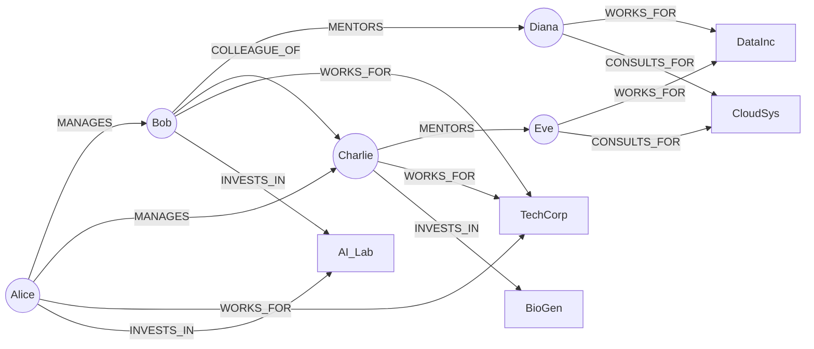

# Punto 4 — Amazon Neptune

Región: **us-east-1** · Cluster: `db-neptune-1` (Serverless, motor 1.4.8.0) · Acceso: túnel SSH mediante EC2

## Estado

| Entregable | Estado | Evidencia |
|---|---|---|
| Cluster Neptune desplegado (Serverless) | ✅ | [`01_cluster_neptune_serverless.png`](evidencias/01_cluster_neptune_serverless.png) |
| EC2 para el túnel, en la misma VPC | ✅ | [`02_ec2_tunel.png`](evidencias/02_ec2_tunel.png) |
| Túnel SSH abierto | ✅ | [`03_tunel_ssh_conectado.png`](evidencias/03_tunel_ssh_conectado.png) |
| Script `neptune_queries.py` | ✅ corregido | [`neptune_queries.py`](neptune_queries.py) |
| Ejecución del script con resultados | 🟡 pendiente de captura | — |
| Eliminación de recursos | 🟡 pendiente de captura | — |

Los resultados de la sección 5 son los **esperados**, deducidos del grafo. Deben reemplazarse por la salida real cuando se ejecute el script.

---

## 1. Neptune frente a Neo4j

| Aspecto | Amazon Neptune | Neo4j |
|---|---|---|
| **Modelo de datos** | Property graph (vértices y aristas con propiedades) **y** RDF (tripletas), en el mismo servicio | Property graph (nodos, relaciones y propiedades) |
| **Lenguajes de consulta** | Gremlin y openCypher (property graph) y SPARQL (RDF) | Cypher, su lenguaje nativo |
| **Despliegue** | Servicio administrado de AWS. Solo existe dentro de AWS (VPC) | Autoalojado (Community/Enterprise) o administrado (AuraDB) |
| **Almacenamiento y alta disponibilidad** | Volumen compartido replicado en varias zonas de disponibilidad; réplicas de lectura | Clustering en Enterprise; en Aura lo gestiona el proveedor |
| **Herramientas** | Neptune Workbench (Jupyter), `graph-notebook`, integración con S3, Lambda e IAM, Neptune ML, Neptune Analytics | Neo4j Browser, Bloom, Graph Data Science, ecosistema APOC, drivers oficiales |
| **Seguridad** | IAM, VPC, grupos de seguridad, cifrado con KMS | Roles y usuarios propios, cifrado según edición |
| **Cuándo conviene** | Ya se está en AWS y se quiere operar sin administrar servidores. Se necesita RDF/SPARQL | Se busca el ecosistema de Cypher y analítica de grafos madura, o se quiere independencia de nube |

## 2. Despliegue y elección entre aprovisionado y Serverless

El cluster `db-neptune-1` se creó en **Serverless** (instancias `db.serverless`), motor **1.4.8.0**, con el *writer* en us-east-1d y una réplica de lectura en us-east-1f. Ver [`01_cluster_neptune_serverless.png`](evidencias/01_cluster_neptune_serverless.png).

**Justificación.** La práctica dura pocas horas y la carga es mínima. Serverless evita dimensionar una instancia y se factura por capacidad consumida (NCU) y por segundo. Una instancia aprovisionada pequeña (p. ej. `db.t4g.medium`) también es válida y, si el uso fuera continuo las 24 horas, suele resultar más barata. Para una práctica corta y sin carga predecible, ambas opciones cuestan centavos por hora, y Serverless ahorra el trabajo de elegir tamaño.

**Dos advertencias de costo:**

- Neptune Serverless **no escala a cero**: mientras exista una instancia se factura al menos su capacidad mínima (NCU mínimo).
- El cluster desplegado tiene **writer + réplica de lectura**, es decir, dos instancias facturando. Para el taller basta el *writer*; eliminar la réplica reduce el costo de cómputo a la mitad.

## 3. Cómo consultar Neptune desde local

Neptune vive en una VPC. En la captura se ve **Public connectivity: No**, por lo que el endpoint `*.neptune.amazonaws.com` no es alcanzable desde internet.

| | Túnel SSH mediante EC2 (elegida) | Endpoint público de Neptune |
|---|---|---|
| **Disponibilidad** | Siempre | Desde el motor **1.4.6.x** (el cluster usa 1.4.8.0, así que es posible) |
| **Cómo funciona** | La EC2 está en la misma VPC. `ssh -L` reenvía un puerto local hacia Neptune a través de la EC2 | Se marca `--publicly-accessible` en **cada instancia** del cluster y el endpoint resuelve por internet |
| **Autenticación** | Llave `.pem` para entrar a la EC2. A Neptune se llega por red privada | **Autenticación IAM obligatoria**: cada petición se firma con SigV4. Hay que cambiar el script |
| **Costo adicional** | Una EC2 `t3.micro` (+ IPv4 pública y EBS) | Ninguna instancia extra |
| **Exposición** | Solo el puerto 22 de la EC2, restringido a mi IP | Neptune queda expuesto a internet (protegido por IAM y grupo de seguridad) |

### Arquitectura de acceso (opción elegida)

```
 Mi PC (WSL)                           VPC por defecto  vpc-023acd4f7570f7b0d
┌───────────────────┐   SSH :22   ┌──────────────────────────────┐   TCP :8182   ┌──────────────────────┐
│ neptune_queries.py│ ──────────► │ EC2 Neptune-Tunnel-EC2       │ ────────────► │ Neptune db-neptune-1 │
│ wss://ENDPOINT:   │  (túnel -L) │ t3.micro · IP pública        │  (ruta local  │ Serverless · TLS     │
│   8182/gremlin    │             │ subnet-0049d874d403df7e6     │   de la VPC)  │ sin IP pública       │
└───────────────────┘             └──────────────────────────────┘               └──────────────────────┘
  127.0.0.1:<puerto local>  ◄── reenviado por ssh -L ──►  ENDPOINT_NEPTUNE:8182
```

**VPC y rutas.** La EC2 y Neptune están en la VPC por defecto. La EC2 está en una subred pública (ruta `0.0.0.0/0` hacia el Internet Gateway) para poder recibir el SSH. El tráfico EC2 → Neptune usa la ruta local de la VPC, por lo que no se necesitaron rutas adicionales.

**Grupos de seguridad.**
- EC2: entrada TCP **22** solo desde mi IP.
- Neptune (`default`, `sg-05105fdc7292152e9`): debe permitir entrada TCP **8182** desde el grupo de seguridad de la EC2. Si la EC2 usa el mismo grupo `default`, ya queda cubierto por la regla de autorreferencia.

**Autenticación.**
- SSH con llave privada (`kp.pem`).
- El script no firma las peticiones con SigV4, por lo que asume que el cluster tiene la autenticación IAM **deshabilitada**.
- Neptune exige **TLS**: la conexión es `wss://`.

**¿Es necesario este proceso con EC2? ¿Existe otra manera?** No es obligatorio. Alternativas:

1. **Endpoint público** (motor ≥ 1.4.6.x) con autenticación IAM, sin EC2 pero con exposición a internet.
2. **AWS Systems Manager Session Manager** con *port forwarding* hacia una EC2: no abre el puerto 22 ni exige IP pública.
3. **AWS Client VPN** o **Site-to-Site VPN / Direct Connect**: acceso privado a toda la VPC.
4. **Neptune Workbench** o un entorno dentro de la VPC (SageMaker, Cloud9, Lambda en VPC): las consultas se ejecutan dentro de la red y no se necesita acceso local.

## 4. Modelo del grafo

**10 vértices** (5 `Person`, 5 `Company`) y **15 aristas**.



| Elemento | Detalle |
|---|---|
| Vértices `Person` | Alice, Bob, Charlie, Diana, Eve |
| Vértices `Company` | TechCorp, DataInc, CloudSys, AI_Lab, BioGen |
| Propiedades | `name` (y el ID del vértice es el propio nombre, vía `T.id`) |
| Aristas | `MANAGES` (2), `MENTORS` (2), `COLLEAGUE_OF` (1), `WORKS_FOR` (5), `CONSULTS_FOR` (2), `INVESTS_IN` (3) |

## 5. Consultas y resultados esperados

Se ejecutan desde Python con Gremlin (ver [`neptune_queries.py`](neptune_queries.py)). Cada una recorre relaciones:

| # | Pregunta | Recorrido | Resultado esperado* |
|---|---|---|---|
| 1 | ¿Quiénes están a cargo de Alice? | `g.V("Alice").out("MANAGES")` | `['Bob', 'Charlie']` |
| 2 | ¿En qué empresa trabaja Diana? | `g.V("Diana").out("WORKS_FOR")` | `['DataInc']` |
| 3 | ¿Qué inversores de AI_Lab son además mentores? | `g.V("AI_Lab").in_("INVESTS_IN").where(__.out("MENTORS"))` | `['Bob']` |
| 4 (extra, 3 saltos) | ¿En qué empresas trabajan los mentorados de los subordinados de Alice? | `g.V("Alice").out("MANAGES").out("MENTORS").out("WORKS_FOR").dedup()` | `['DataInc']` |

\*Resultados deducidos del grafo, **pendientes de reemplazar por la captura real**. El orden dentro de la lista puede variar.

## 6. Cómo reproducirlo

```bash
pip install "gremlinpython==3.7.*" boto3   # el motor 1.4.x de Neptune usa TinkerPop 3.7
```

1. **Cluster Neptune** (consola → Neptune → Create cluster → Serverless). Copiar el endpoint del *writer*.
2. **Secreto** en Secrets Manager (tipo *Other*), nombre `NeptuneSecret`:
   ```json
   { "host": "TU_ENDPOINT.us-east-1.neptune.amazonaws.com", "port": "8182" }
   ```
   El script lee de aquí el host y el puerto; no hay nada escrito en el código.
3. **EC2** `Neptune-Tunnel-EC2` (Amazon Linux 2023, `t3.micro`) en la **misma VPC**, con IP pública y llave `.pem`. Permitir en el grupo de seguridad de Neptune el puerto 8182 desde la EC2.
4. **Resolver el endpoint a localhost.** Neptune solo acepta TLS y el certificado es válido para su nombre, no para `127.0.0.1`:
   ```bash
   echo "127.0.0.1  TU_ENDPOINT.us-east-1.neptune.amazonaws.com" | sudo tee -a /etc/hosts
   ```
5. **Abrir el túnel** y dejar esa terminal abierta. El puerto de la izquierda de `-L` debe coincidir con `port` del secreto:
   ```bash
   ssh -i "kp.pem" ec2-user@IP_PUBLICA_EC2 -L 8182:TU_ENDPOINT.us-east-1.neptune.amazonaws.com:8182
   ```
   Verificar desde otra terminal: `nc -zv 127.0.0.1 8182`.
   > En la captura del túnel se usó el puerto local `7697`. Funciona igual si en `NeptuneSecret` el `port` también es `7697`.
6. **Ejecutar:**
   ```bash
   python neptune_queries.py
   ```
   El script borra el grafo anterior, inserta los 10 vértices y las 15 aristas, imprime los conteos y ejecuta las consultas.

### Errores que se corrigieron en el script

- `Graph().traversal()` es la API antigua. Ahora se usa `traversal().with_remote(conn)`.
- `.property("id", ...)` crea una propiedad llamada `id` y no el ID del vértice, por lo que `g.V("Alice")` no encontraba nada. Se usa `T.id`.
- La consulta 3 original (`in_("INVESTS_IN").in_("MENTORS")`) devolvía vacío, porque recorría el camino equivocado. Ahora usa `where(out("MENTORS"))`.
- Había **14** relaciones y el enunciado pide 15. Se añadió `Bob → Charlie (COLLEAGUE_OF)`.
- El script se puede ejecutar varias veces sin duplicar datos.

## 7. Costos

Valores aproximados para **us-east-1**, tomados de las páginas de precios de AWS y de terceros en octubre de 2026. Confirmar en la [calculadora de AWS](https://calculator.aws/).

| Componente | Precio aproximado | Observación |
|---|---|---|
| **Cómputo Serverless** | ≈ US$0.11 por NCU-hora (por segundo) | Capacidad mínima configurable; **no escala a cero** |
| Instancias del cluster | 2 (writer + réplica) | Cada una factura su capacidad mínima |
| **Almacenamiento** | ≈ US$0.10 por GB-mes (solo lo usado) | Este grafo ocupa muy poco |
| **I/O** (almacenamiento estándar) | ≈ US$0.20 por millón de peticiones | Insignificante en esta práctica |
| Respaldos | Gratis hasta el 100 % del almacenamiento | Los respaldos automáticos se eliminan con el cluster |
| **EC2 del túnel** (`t3.micro`) | ≈ US$0.0104/h + IPv4 pública ≈ US$0.005/h + EBS 8 GB | Sí: **este método añade una EC2** |

**Estimación de la práctica (3 horas, cluster con 2 instancias de 1 NCU):** 2 × 1 NCU × 0.11 × 3 h ≈ **US$0.66** de cómputo, más ≈ US$0.05 de la EC2. Total ≈ **US$0.7**. Con solo el *writer* serían ≈ US$0.35.

**¿Qué se sigue cobrando mientras no se ejecutan consultas?**
- La capacidad mínima de cada instancia Serverless, mientras exista.
- El almacenamiento y los respaldos que excedan el 100 %.
- La EC2 encendida, su IPv4 pública y su disco EBS. Si solo se *detiene*, el EBS sigue facturando.
- El secreto en Secrets Manager (≈ US$0.40/mes, prorrateado).

## 8. Eliminación de recursos

```bash
# 1) Instancias del cluster (writer y réplica) y luego el cluster, sin snapshot final
aws neptune delete-db-instance --db-instance-identifier db-neptune-1-instance-1 --region us-east-1
aws neptune delete-db-instance --db-instance-identifier db-neptune-1-instance-1-us-east-1f --region us-east-1
aws neptune delete-db-cluster  --db-cluster-identifier db-neptune-1 --skip-final-snapshot --region us-east-1

# 2) EC2 del túnel
aws ec2 terminate-instances --instance-ids i-0320319244dcf6d00 --region us-east-1

# 3) Secreto
aws secretsmanager delete-secret --secret-id NeptuneSecret --force-delete-without-recovery --region us-east-1

# 4) Verificación: no debe quedar nada
aws neptune describe-db-clusters --region us-east-1 --query 'DBClusters[].DBClusterIdentifier'
aws ec2 describe-instances --region us-east-1 --query 'Reservations[].Instances[].[InstanceId,State.Name]'
```

También revisar en la consola: grupos de seguridad creados para el taller, volúmenes EBS y la entrada añadida a `/etc/hosts`. **Pendiente:** adjuntar la captura de la eliminación en `evidencias/`.
